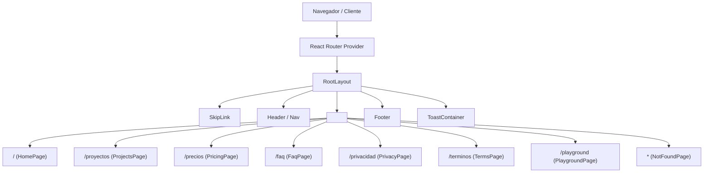
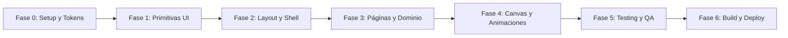
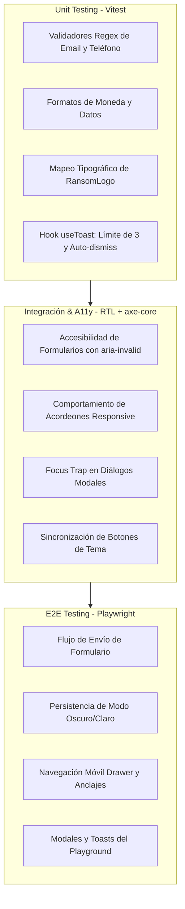

# Plan Maestro de Migración a React + TypeScript: Vitrina Studio

> **Versión del Documento:** 1.0  
> **Objetivo:** Hoja de ruta técnica completa y autocontenida para reconstruir el proyecto **Vitrina Studio** desde cero en React con TypeScript, garantizando paridad funcional al 100%, máxima accesibilidad (WCAG AA), arquitectura modular escalable y una estrategia rigurosa de testing.

---

## Índice General

1. [Diagnóstico del Proyecto Actual vs. Objetivo React](#1-diagnóstico-del-proyecto-actual-vs-objetivo-react)
2. [Stack Tecnológico y Justificación Arquitectónica](#2-stack-tecnológico-y-justificación-arquitectónica)
3. [Estructura de Directorios del Nuevo Proyecto](#3-estructura-de-directorios-del-nuevo-proyecto)
4. [Catálogo Exhaustivo de Componentes](#4-catálogo-exhaustivo-de-componentes)
   - [4.1 Primitivas de UI y Sistema de Diseño (Base / Playground)](#41-primitivas-de-ui-y-sistema-de-diseño-base--playground)
   - [4.2 Elementos de Identidad y Gráficos Interactivos](#42-elementos-de-identidad-y-gráficos-interactivos)
   - [4.3 Layout y Shell Global](#43-layout-y-shell-global)
   - [4.4 Componentes de Dominio y Secciones](#44-componentes-de-dominio-y-secciones)
5. [Enrutamiento y Especificaciones por Página](#5-enrutamiento-y-especificaciones-por-página)
6. [Gestión de Estado Global y Custom Hooks](#6-gestión-de-estado-global-y-custom-hooks)
7. [Metodología de Desarrollo y Fases de Ejecución](#7-metodología-de-desarrollo-y-fases-de-ejecución)
8. [Estrategia Integral de Testing y QA](#8-estrategia-integral-de-testing-y-qa)
9. [Runbook de Comandos y Checklist Paso a Paso](#9-runbook-de-comandos-y-checklist-paso-a-paso)

---

## 1. Diagnóstico del Proyecto Actual vs. Objetivo React

### 1.1 Estado Actual (Vanilla Web)
- **Tecnología:** HTML5 estático multipágina (7 páginas: `index`, `proyectos`, `precios`, `faq`, `privacidad`, `terminos`, `playground`), CSS modularizado por capas mediante `@import` (`variables.css`, `layout.css`, `components.css`, `pages.css`, `responsive.css` + CSS de backoffice), TypeScript sin empaquetador compilado a scripts globales en `js/`.
- **Puntos críticos de fricción:**
  - Código duplicado masivo: `<head>`, SEO tags, analítica (GTM, Mixpanel, ContentSquare), cabecera, navegación drawer y pie de página replicados manualmente en cada archivo HTML.
  - Script anti-FOUC repetido inline en el `<head>` de cada archivo.
  - Manipulación directa del DOM (`document.querySelector`, `classList`, listeners globales) para eventos de UI (menús, modales, toasts, acordeones, validaciones).
  - Riesgo alto de desincronización en cambios de enlaces, textos legales o tokens de diseño.

### 1.2 Estado Objetivo (React SPA)
- **Tecnología:** Single Page Application (SPA) en **React 18/19** con **TypeScript estricto**, empaquetado con **Vite**, gestionado con **React Router v6/v7**, estilos con CSS Modules / PostCSS (o Tailwind manteniendo los tokens estrictos del Brand System), y animaciones orquestadas mediante Framer Motion o `@gsap/react`.
- **Beneficios clave:**
  - Componentización pura: Header, Footer, Cards, Acordeones y Formularios definidos una sola vez con interfaces fuertemente tipadas.
  - Estado reactivo predecible para el cambio de tema, toasts, modales y validación en tiempo real.
  - Rutas client-side ultra fluidas con preservación de scroll y anclajes directos (`#contacto`).
  - Cobertura de pruebas automatizadas (Unitarias, Integración, Accesibilidad y E2E).

---

## 2. Stack Tecnológico y Justificación Arquitectónica

| Categoría | Herramienta / Librería | Versión Recomendada | Justificación Técnica |
| :--- | :--- | :--- | :--- |
| **Entorno & Bundler** | **Vite** | 5.x / 6.x | Configuración mínima, arranque en frío instantáneo con ES Modules, HMR milimétrico. |
| **Librería Core** | **React + React DOM** | 18.3+ o 19 | Estándar de la industria, concurrencia, soporte maduro de hooks y tipado estricto. |
| **Lenguaje** | **TypeScript** | 5.5+ | Tipado estricto (`strict: true`) para evitar regresiones en props, contratos de datos y eventos del DOM. |
| **Enrutamiento** | **React Router** | 6.26+ | Soporte nativo para rutas anidadas, layouts compartidos, `ScrollRestoration` y navegación por hash. |
| **Estilos & Tokens** | **CSS Modules + Variables CSS Nativas** | Nativo Vite | Encapsulamiento de estilos por componente en archivos `.module.css` con reutilización directa del 100% de los tokens de `variables.css` y reglas de `components.css`. Elección confirmada. |
| **Animaciones** | **GSAP (`@gsap/react` + `ScrollTrigger`)** | GSAP 3.12+ | Mantiene con exactitud las físicas actuales (ScrollTrigger batching, entrada lateral de tarjetas y animaciones condicionales para `prefers-reduced-motion`). Elección confirmada. |
| **Formularios & Validación** | **React Hook Form + Zod** | RHF 7.x + Zod 3.x | Rendimiento óptimo sin re-renders innecesarios, validación desacoplada con schemas tipados y gestión accesible de errores (`aria-invalid`, `aria-describedby`). |
| **Gestión de Head / SEO** | **React Helmet Async** | 2.0+ | Gestión declarativa de `<title>`, meta description, canonical, Open Graph y Twitter Cards por ruta. |
| **Analítica** | **Módulos encapsulados (Mixpanel, GA4)** | `mixpanel-browser` | Sustituye los scripts pegados en `<head>` por un servicio reactivo centralizado con tipado de eventos. |
| **Testing Unitario** | **Vitest + React Testing Library + axe-core** | Vitest 2.x | Integración nativa con Vite, tests rápidos en memoria y comprobación automática de accesibilidad con `jest-axe`. |
| **Testing E2E** | **Playwright** | 1.46+ | Pruebas end-to-end multi-navegador (Chromium, Firefox, WebKit) para flujos críticos: navegación, formulario de contacto, diálogo modal y persistencia del tema. |

---

## 3. Estructura de Directorios del Nuevo Proyecto

```text
vitrina-studio-react/
├── .github/
│   └── workflows/
│       └── ci.yml                 # Pipeline CI (lint, typecheck, test, e2e, build)
├── public/
│   ├── favicon.svg                # Isotipo SVG oficial
│   ├── robots.txt                 # Robots SEO
│   ├── sitemap.xml                # Mapa de sitio XML
│   └── video/                     # Videos corporativos optimizados
│       └── HeroVideo.compressed.mp4
├── src/
│   ├── assets/                    # Imágenes y vectores importables
│   │   ├── images/                # EcommerExample.png, image1.png, etc.
│   │   └── vectors/               # SVGs de proyectos y planes
│   ├── components/                # Catálogo modular de componentes
│   │   ├── brand/                 # Identidad: RansomLogo, Isotipo, Watermark, Bombilla
│   │   ├── feedback/              # Alert, Toast, ToastContainer
│   │   ├── form/                  # Input, Select, Textarea, Checkbox, Radio, ContactForm
│   │   ├── layout/                # Header, Footer, SkipLink, PageContainer, SectionHead
│   │   ├── overlay/               # Dialog (Modal), DropdownMenu
│   │   └── sections/              # Secciones de la landing y páginas de producto
│   ├── context/                   # Proveedores de estado global
│   │   ├── ThemeContext.tsx       # Modo oscuro/claro con anti-FOUC
│   │   └── ToastContext.tsx       # Cola global de notificaciones
│   ├── data/                      # Datos estáticos tipados (proyectos, precios, FAQ, testimonios)
│   │   ├── faq.data.ts
│   │   ├── plans.data.ts
│   │   ├── projects.data.ts
│   │   ├── services.data.ts
│   └── testimonials.data.ts
│   ├── hooks/                     # Custom hooks reutilizables
│   │   ├── useAnalytics.ts        # Dispatch de eventos Mixpanel / GA4
│   │   ├── useCanvasGrid.ts       # Loop interactivo Canvas 2D
│   │   ├── useMediaQuery.ts       # Detección responsiva y prefers-reduced-motion
│   │   ├── useScrollSpy.ts        # Seguimiento de secciones activas
│   │   └── useTypewriter.ts       # Efecto máquina de escribir para el kicker del Hero
│   ├── pages/                     # Páginas de la aplicación (Rutas)
│   │   ├── HomePage.tsx           # /
│   │   ├── ProjectsPage.tsx       # /proyectos
│   │   ├── PricingPage.tsx        # /precios
│   │   ├── FaqPage.tsx            # /faq
│   │   ├── PrivacyPage.tsx        # /privacidad
│   │   ├── TermsPage.tsx          # /terminos
│   │   ├── PlaygroundPage.tsx     # /playground (Showcase de componentes)
│   │   └── NotFoundPage.tsx       # 404
│   ├── routes/                    # Configuración de React Router
│   │   ├── AppRoutes.tsx
│   │   └── RootLayout.tsx
│   ├── services/                  # Servicios de terceros
│   │   ├── analytics.ts           # Inicialización e integración de Mixpanel/GA4
│   │   └── contact.ts             # Simulación / API de envío de formulario
│   ├── styles/                    # Tokens globales y estilos base
│   │   ├── tokens.css             # :root y variables de color, tipografía y radios
│   │   ├── typography.css         # Importación de fuentes de Google Fonts
│   │   ├── reset.css              # Resets de accesibilidad y caja
│   │   └── main.css               # Agregador global
│   ├── types/                     # Definiciones globales de TypeScript
│   │   ├── analytics.types.ts
│   │   ├── form.types.ts
│   │   └── models.types.ts
│   ├── utils/                     # Utilidades puras
│   │   ├── cn.ts                  # Helper de clases condicionales
│   │   └── formatters.ts          # Formato de números y monedas
│   ├── App.tsx                    # Raíz de proveedores
│   └── main.tsx                   # Punto de entrada Vite
├── tests/
│   ├── e2e/                       # Tests Playwright
│   │   ├── contact-flow.spec.ts
│   │   ├── navigation.spec.ts
│   │   ├── playground.spec.ts
│   │   └── theme-toggle.spec.ts
│   ├── setup.ts                   # Setup de Vitest y mocks de MatchMedia/Canvas
│   └── unit/                      # Tests unitarios y de componentes
├── index.html                     # Plantilla HTML única con script anti-FOUC
├── package.json
├── playwright.config.ts
├── tsconfig.json
└── vite.config.ts
```

---

## 4. Catálogo Exhaustivo de Componentes

### 4.1 Primitivas de UI y Sistema de Diseño (Base / Playground)

#### 1. `Button`
- **Ruta:** `src/components/ui/Button.tsx`
- **Propósito:** Botón base y variante enlace con soporte para estilos de marca.
- **Props Interface:**
  ```typescript
  export interface ButtonProps extends React.ButtonHTMLAttributes<HTMLButtonElement> {
    variant?: 'primary' | 'solid' | 'ghost' | 'destructive';
    size?: 'sm' | 'md' | 'lg';
    asChild?: boolean;
    href?: string;
  }
  ```
- **Detalle de Accesibilidad:**
  - Incluye selector `:focus-visible` con anillo coral `var(--focus)`.
  - Si es enlace (`href`), se renderiza como `<a>` con soporte para `rel="noopener noreferrer"` si es externo.

#### 2. `Alert`
- **Ruta:** `src/components/feedback/Alert.tsx`
- **Propósito:** Mensaje estático o descartable de estado.
- **Props Interface:**
  ```typescript
  export interface AlertProps {
    variant: 'success' | 'warning' | 'error' | 'info';
    title?: string;
    children: React.ReactNode;
    onClose?: () => void;
    dismissible?: boolean;
  }
  ```
- **Detalle de Accesibilidad:**
  - `role="status"` o `role="alert"` según severidad.
  - Botón de cierre con `aria-label="Cerrar alerta"`.

#### 3. `Toast` & `ToastContainer`
- **Ruta:** `src/components/feedback/Toast.tsx` y `ToastContainer.tsx`
- **Propósito:** Notificaciones emergentes fijas (máximo 3 visibles, auto-dismiss en 5000ms).
- **Props Interface:**
  ```typescript
  export interface ToastItem {
    id: string;
    variant: 'success' | 'error';
    message: string;
    duration?: number;
  }
  ```
- **Detalle de Accesibilidad:**
  - Contenedor con `aria-live="polite"` y `aria-atomic="false"`.

#### 4. `Dialog` (Modal)
- **Ruta:** `src/components/overlay/Dialog.tsx`
- **Propósito:** Ventana modal nativa o personalizada con backdrop oscuro.
- **Props Interface:**
  ```typescript
  export interface DialogProps {
    isOpen: boolean;
    onClose: () => void;
    title: string;
    description?: string;
    children: React.ReactNode;
    onConfirm?: () => void;
    confirmText?: string;
    cancelText?: string;
  }
  ```
- **Detalle de Accesibilidad:**
  - Implementa trap de foco por teclado (`Tab` / `Shift + Tab`).
  - Cierre inmediato con tecla `Escape`.
  - Retorno de foco al elemento disparador (`triggerRef`) tras el cierre.
  - Atributos `aria-labelledby` y `aria-describedby` mapeados a título y descripción.

#### 5. `DropdownMenu`
- **Ruta:** `src/components/overlay/DropdownMenu.tsx`
- **Propósito:** Menú flotante (ej. cuenta de usuario en playground).
- **Props Interface:**
  ```typescript
  export interface DropdownMenuItem {
    label: string;
    onClick: () => void;
    isDestructive?: boolean;
  }
  export interface DropdownMenuProps {
    trigger: React.ReactNode;
    items: DropdownMenuItem[];
  }
  ```
- **Detalle de Accesibilidad:**
  - `aria-haspopup="menu"`, `aria-expanded` dinámico y listener para cerrar al hacer clic fuera o presionar `Escape`.

#### 6. Controles de Formulario (`Input`, `Select`, `Textarea`, `Checkbox`, `Radio`)
- **Rutas:** `src/components/form/Input.tsx`, `Select.tsx`, `Textarea.tsx`, `Checkbox.tsx`, `Radio.tsx`
- **Propósito:** Campos atómicos estilizados según los tokens de Vitrina Studio, con soporte nativo para mensajes de error accesibles.
- **Patrón ARIA Clave:**
  ```tsx
  // Cada campo recibe 'error?: string'
  <input
    id={id}
    aria-invalid={!!error}
    aria-describedby={error ? `${id}-error` : undefined}
    className={cn("form-input", error && "is-invalid")}
    {...props}
  />
  {error && (
    <span id={`${id}-error`} className="form-error" role="alert">
      {error}
    </span>
  )}
  ```

---

### 4.2 Elementos de Identidad y Gráficos Interactivos

#### 1. `RansomLogo`
- **Ruta:** `src/components/brand/RansomLogo.tsx`
- **Propósito:** Renderizado de la marca "vitrina" con contraste tipográfico deliberado letra por letra según el Brand Identity System de `DESIGN.md`.
- **Mapeo de Letras Tipográficas:**
  ```typescript
  export const VITRINA_LETTERS = [
    { char: 'v', font: "'Instrument Sans', sans-serif", weight: 800, coral: false },
    { char: 'i', font: "'Outfit', sans-serif", weight: 700, coral: false },
    { char: 't', font: "'Barlow Condensed', sans-serif", weight: 800, coral: true },
    { char: 'r', font: "'IBM Plex Sans', sans-serif", weight: 800, coral: true },
    { char: 'i', font: "'Instrument Sans', sans-serif", weight: 800, coral: false },
    { char: 'n', font: "'DM Sans', sans-serif", weight: 700, coral: false },
    { char: 'a', font: "'Instrument Sans', sans-serif", weight: 800, coral: false },
  ];
  ```
- **Regla de Coherencia:** Mismo tamaño, misma altura de línea (1), misma línea base, mismo tracking (`-0.02em`). Se complementa con la etiqueta `studio` en `Outfit 300` con `letter-spacing: 0.22em`.

#### 2. `HeroBrandCanvas`
- **Ruta:** `src/components/brand/HeroBrandCanvas.tsx`
- **Propósito:** Lienzo HTML5 Canvas 2D interactivo de fondo en el Hero.
- **Lógica encapsulada:**
  - Cuadrícula de 60px de espaciado.
  - Puntero interactivo con radio de influencia de 190px y curva de atenuación exponencial cuadrática.
  - Engrosamiento de trazo de 1px a 3.4px y aumento de opacidad de 0.06 a 0.42.
  - Soporte automático para Device Pixel Ratio (`dpr`).
  - Detección reactiva del color `--hero-grid-rgb` según el tema actual.
  - Pausa automática de la animación cuando el puntero sale o si el usuario tiene habilitado `prefers-reduced-motion`.

#### 3. `TypewriterKicker`
- **Ruta:** `src/components/brand/TypewriterKicker.tsx`
- **Propósito:** Texto dinámico en la parte superior del Hero que tipea y borra secuencialmente las palabras clave (`conversión`, `performance`, `tiendas que venden`, `SEO real`, `diseño no-genérico`, `ventas automatizadas`).
- **Accesibilidad:** Incluye un elemento `<span class="sr-only">` con el texto completo para que los lectores de pantalla lean todas las especialidades sin depender del temporizador.

#### 4. `BombillaLuz`
- **Ruta:** `src/components/brand/BombillaLuz.tsx`
- **Propósito:** Gráfico SVG de la bombilla en la sección "Cómo trabajamos" que enciende su resplandor granulado mediante `IntersectionObserver` al 20% de visibilidad en pantalla.

#### 5. `BrowserChrome`
- **Ruta:** `src/components/brand/BrowserChrome.tsx`
- **Propósito:** Maqueta de ventana de navegador (con los tres puntos y barra de URL) reutilizada en los casos de éxito y en el detalle de planes.

---

### 4.3 Layout y Shell Global

#### 1. `Header` & `MobileNav`
- **Ruta:** `src/components/layout/Header.tsx`
- **Propósito:** Barra de navegación superior fija (`var(--header-bg)`) con isotipo/logotipo, enlaces a páginas (`Proyectos`, `Precios`, `FAQ`), botón CTA `Contáctanos` (ancla `#contacto`), y conmutador de tema.
- **Comportamiento Mobile:** Menú drawer desplegable mediante estado reactivo `isMenuOpen`, con bloqueo de scroll en el body (`overflow: hidden`), cierre al hacer clic en el backdrop o al navegar de ruta, y accesibilidad con `aria-expanded`.

#### 2. `ThemeToggle`
- **Ruta:** `src/components/layout/ThemeToggle.tsx`
- **Propósito:** Botón conmutador entre modo claro y oscuro.
- **Accesibilidad:** Refleja el estado en tiempo real con `aria-pressed={isDark}` y `aria-label={isDark ? "Activar modo claro" : "Activar modo oscuro"}`.

#### 3. `Footer`
- **Ruta:** `src/components/layout/Footer.tsx`
- **Propósito:** Pie de página con tres columnas informativas (Descripción de Vitrina, Enlaces de contacto, Redes sociales con `target="_blank"` y texto accesible para pestaña nueva), barra legal inferior con enlaces a `/privacidad`, `/terminos` y botón de retorno al inicio (`#top`).

#### 4. `SkipLink`
- **Ruta:** `src/components/layout/SkipLink.tsx`
- **Propósito:** Enlace invisible para navegación asistida que aparece con foco por teclado y salta directamente al contenido principal (`#main`).

---

### 4.4 Componentes de Dominio y Secciones

#### 1. `ServiceCard` & `ServicesSection`
- **Ruta:** `src/components/sections/ServiceCard.tsx` y `ServicesSection.tsx`
- **Estructura:** Lista ordenada con marcas de categoría (`DISEÑO`, `CATÁLOGO`, `PAGOS`, `CRECIMIENTO`), título h3 y descripción.

#### 2. `ProcessStep` & `HowWeWorkSection`
- **Ruta:** `src/components/sections/ProcessStep.tsx` y `HowWeWorkSection.tsx`
- **Estructura:** `<ol>` semántico con números de paso con `aria-hidden="true"` (`01 Descubrimiento`, `02 Diseño`, `03 Construcción`, `04 Lanzamiento`) acompañado de la `BombillaLuz`.

#### 3. `ProjectCard` & `ProjectsList`
- **Ruta:** `src/components/sections/ProjectCard.tsx`
- **Características:** Renderiza cada caso de estudio con su tag de resultado (`3.2× más pedidos`, `Checkout en 30s`, etc.), contenedor `BrowserChrome` con SVG ilustrativo, y acordeón de historia técnica.
- **Lógica Responsiva:** Utiliza el hook `useMediaQuery('(min-width: 900px)')` para mantener abierto el detalle en pantallas de escritorio y colapsable en móviles.

#### 4. `PricingCard` & `PricingGrid`
- **Ruta:** `src/components/sections/PricingCard.tsx`
- **Características:** Presenta los tres planes (`Escaparate`, `Vitrina`, `Boutique a medida`), destacando el plan popular (`Más elegido`), lista de características con checks, precio formateado y tracking de clic con Mixpanel (`plan_clicked`).

#### 5. `TestimonialCard` & `TestimonialsSection`
- **Ruta:** `src/components/sections/TestimonialCard.tsx`
- **Estructura Semántica:** `<blockquote>` con cita auténtica + `<cite>` con nombre y cargo del cliente real/simulado.

#### 6. `ContactForm` & `ContactSection`
- **Ruta:** `src/components/sections/ContactForm.tsx`
- **Campos Controlados:**
  - `nombre`: requerido, mínimo 2 caracteres.
  - `email`: requerido, validación estricta con regex RFC compatible.
  - `telefono`: requerido, patrón regex `^[0-9+\s-]{7,15}$`.
  - `plan`: selector obligatorio de planes.
  - `mensaje`: requerido, mínimo 10 caracteres.
- **Feedback:** Región en vivo con `aria-live="polite"` que anuncia éxito o error de validación sin recargar la página.

---

## 5. Enrutamiento y Especificaciones por Página

La aplicación implementa **React Router** con un `RootLayout` que encapsula la cabecera, el contenedor principal de vista y el pie de página común.



### Tabla de Especificación de Rutas

| Ruta | Componente de Página | Heading `<h1>` | Metadata SEO (Title / Canonical) | Secciones Clave |
| :--- | :--- | :--- | :--- | :--- |
| `/` | `HomePage` | *Vitrina Studio (Ransom Logo)* | `Vitrina Studio — Diseñamos y construimos tu tienda en línea` | Hero Brand, Servicios, Cómo trabajamos, Caso éxito, Testimonios, Nosotros, Contacto |
| `/proyectos` | `ProjectsPage` | `Tiendas que hemos construido` | `Proyectos — Vitrina Studio` | Intro, 5 Tarjetas de Proyectos con Acordeón responsivo, CTA final |
| `/precios` | `PricingPage` | `Un plan para cada etapa de tu negocio` | `Precios — Vitrina Studio` | Intro, Grilla de 3 Precios, 3 Desgloses detallados con mockups, Nota de hosting |
| `/faq` | `FaqPage` | `Dudas comunes antes de abrir tu tienda` | `Preguntas frecuentes — Vitrina Studio` | Intro, Lista de 6 Acordeones accesibles (`<details>`), CTA final |
| `/privacidad` | `PrivacyPage` | `Política de privacidad` | `Política de privacidad — Vitrina Studio` | 8 secciones legales estructuradas en `<article className="legal-body">` |
| `/terminos` | `TermsPage` | `Términos y condiciones` | `Términos y condiciones — Vitrina Studio` | 7 secciones de condiciones de servicio en `<article className="legal-body">` |
| `/playground` | `PlaygroundPage` | `Playground de Componentes` | `Design System Playground — Vitrina Studio` | Aside de navegación interna, Demos: Alerts, Botones, Checkboxes/Radios, Dialogs, Menús, Toasts |
| `*` | `NotFoundPage` | `404 — Página no encontrada` | `Página no encontrada — Vitrina Studio` | Mensaje de error amigable y botón de retorno al inicio |

---

## 6. Gestión de Estado Global y Custom Hooks

### 6.1 `ThemeContext` & `useTheme`
- **Archivo:** `src/context/ThemeContext.tsx`
- **Funciones:**
  - Lee el tema inicial de `localStorage.getItem('theme')` o `window.matchMedia('(prefers-color-scheme: dark)')`.
  - Establece el atributo `data-theme="dark" | "light"` en el elemento `document.documentElement`.
  - Mantiene sincronizado el estado en todos los botones `ThemeToggle` del árbol.
  - Guarda cualquier cambio en `localStorage`.

### 6.2 `ToastContext` & `useToast`
- **Archivo:** `src/context/ToastContext.tsx`
- **Funciones:**
  - Expone el método `showToast(variant: 'success' | 'error', message: string, duration?: number)`.
  - Controla una cola de máximo 3 elementos para no saturar la pantalla.
  - Temporizador de auto-remoción (`setTimeout`) con limpieza en desmontaje.

### 6.3 `useCanvasGrid`
- **Archivo:** `src/hooks/useCanvasGrid.ts`
- **Parámetros:** `canvasRef: React.RefObject<HTMLCanvasElement>`, `containerRef: React.RefObject<HTMLElement>`
- **Funciones:**
  - Inicializa el contexto 2D y redimensiona con `ResizeObserver`.
  - Escucha eventos `pointermove` y `pointerleave` para calcular coordenadas locales relativas.
  - Ejecuta el bucle de interpolación cuadrática mediante `requestAnimationFrame`.
  - Detecta cambios de tema reactivamente para repintar las líneas con el contraste adecuado.

### 6.4 `useTypewriter`
- **Archivo:** `src/hooks/useTypewriter.ts`
- **Parámetros:** `words: string[]`, opciones de temporización (`typeSpeed`, `deleteSpeed`, `holdTime`, `gapTime`).
- **Retorno:** `currentText: string`, `isTyping: boolean`.

### 6.5 `useAnalytics`
- **Archivo:** `src/hooks/useAnalytics.ts`
- **Funciones:**
  - Envía automáticamente un evento `Page View` al cambiar de ruta con `useLocation()`.
  - Expone funciones helper tipadas: `trackPlanClicked(planName: string)`, `trackContactSubmitted()`.

---

## 7. Metodología de Desarrollo y Fases de Ejecución

Se aplicará una metodología iterativa basada en **Feature-Driven Development (FDD)** y **Atomic Design**, organizada en 6 fases estrictamente secuenciales. Cada fase cuenta con un **Definition of Done (DoD)** que debe validarse antes de avanzar a la siguiente.



### Fase 0: Inicialización y Fundaciones de Diseño
- Crear proyecto con Vite + React + TypeScript.
- Configurar ESLint, Prettier y TypeScript en modo estricto.
- Migrar tokens completos de color, tipografía, espaciados y radios a `src/styles/tokens.css`.
- Importar las fuentes oficiales desde Google Fonts en `src/styles/typography.css`.
- **DoD:** La aplicación compila sin errores (`npm run build`), no hay advertencias de linter y los tokens CSS están disponibles globalmente.

### Fase 1: Primitivas UI y Playground
- Crear componentes base: `Button`, `Alert`, `Input`, `Select`, `Textarea`, `Checkbox`, `Radio`.
- Crear primitivas de interacción: `Dialog` (con trap de foco), `DropdownMenu` y sistema de `Toast`.
- Implementar la página `/playground` para verificar visualmente cada estado (hover, focus, disabled, error).
- **DoD:** Todos los componentes del playground son navegables completamente por teclado y pasan los tests unitarios básicos.

### Fase 2: Shell Global y Estado de Tema
- Implementar `ThemeContext` y el script anti-FOUC en `index.html`.
- Construir `Header`, `MobileNav` (con animación de apertura/cierre), `ThemeToggle` y `Footer`.
- Configurar `React Router` con `RootLayout`, `SkipLink` y `ScrollRestoration`.
- **DoD:** El tema se alterna instantáneamente sin parpadeo de color al recargar la página; el menú responsive abre y cierra correctamente bloqueando el scroll del body.

### Fase 3: Páginas de Dominio y Contenido
- Trasladar los datos estáticos a archivos tipados (`src/data/*.ts`).
- Construir componentes de sección: `ServicesSection`, `HowWeWorkSection`, `TestimonialsSection`, `ProjectCard`, `PricingCard`.
- Desarrollar las páginas: `HomePage`, `ProjectsPage`, `PricingPage`, `FaqPage`, `PrivacyPage`, `TermsPage`.
- Implementar el formulario de contacto con validación en tiempo real y mensajes accesibles.
- **DoD:** Todas las rutas son accesibles; el formulario valida exactamente según las reglas de negocio (nombre, email, teléfono, plan, mensaje).

### Fase 4: Interactividad Avanzada y Canvas
- Integrar `HeroBrandCanvas` con el custom hook `useCanvasGrid`.
- Integrar el efecto `TypewriterKicker` en el Hero.
- Configurar la animación de la `BombillaLuz` con `IntersectionObserver`.
- Orquestar las animaciones de scroll (Framer Motion o ScrollTrigger) respetando `prefers-reduced-motion`.
- **DoD:** El canvas responde fluidamente al cursor a 60 FPS; al activar "reducir movimiento" en el sistema operativo, las animaciones se desactivan sin romper el layout.

### Fase 5: Estrategia de Pruebas y Auditoría de Calidad
- Ejecutar suite de pruebas unitarias en Vitest con React Testing Library.
- Ejecutar comprobación de accesibilidad automatizada con `axe-core`.
- Desarrollar y ejecutar tests E2E en Playwright para flujos críticos.
- **DoD:** Cobertura de tests unitarios superior al 80% en componentes clave, cero errores críticos en axe-core y todos los tests E2E en verde.

### Fase 6: Optimización de Build y Preparación para Producción
- Configurar metadata SEO dinámica con `react-helmet-async`.
- Auditar tamaño de bundles en Vite (`vite-plugin-visualizer`).
- Configurar robots.txt y sitemap.xml en la carpeta `public/`.
- **DoD:** Puntuación de Google Lighthouse superior a 95 en Rendimiento, Accesibilidad, Buenas Prácticas y SEO.

---

## 8. Estrategia Integral de Testing y QA

### 8.1 Niveles de Testing



### 8.2 Casos de Prueba Críticos

#### 1. Formulario de Contacto (`src/components/sections/ContactForm.test.tsx`)
- **TC-01:** Bloqueo de envío cuando los campos están vacíos, mostrando mensajes de error asociados mediante `aria-describedby`.
- **TC-02:** Validación de formato erróneo de email (`correo-invalido`) y teléfono fuera de rango (menos de 7 o más de 15 caracteres).
- **TC-03:** Envío exitoso con datos correctos: limpieza de inputs, anuncio en región `aria-live="polite"` y disparo del evento analítico.

#### 2. Conmutador de Tema (`src/context/ThemeContext.test.tsx`)
- **TC-04:** Detección inicial del esquema de color preferido por el sistema (`prefers-color-scheme`).
- **TC-05:** Alternancia de clase/atributo `data-theme` en `<html>` al accionar el botón `ThemeToggle`.
- **TC-06:** Persistencia del valor seleccionado en `localStorage`.

#### 3. Diálogo Modal (`src/components/overlay/Dialog.test.tsx`)
- **TC-07:** Bloqueo de tabulación dentro del modal cuando está abierto (Focus Trap).
- **TC-08:** Cierre mediante tecla `Escape` y retorno de foco al elemento previo.

---

## 9. Runbook de Comandos y Checklist Paso a Paso

### 9.1 Comandos de Inicialización

Ejecutar estos comandos en la terminal para crear y configurar el nuevo espacio de trabajo:

```bash
# 1. Crear el proyecto React con Vite y TypeScript
npm create vite@latest vitrina-studio -- --template react-ts

# 2. Ingresar al directorio
cd vitrina-studio

# 3. Instalar dependencias de producción
npm install react-router-dom react-helmet-async react-hook-form zod @hookform/resolvers clsx mixpanel-browser gsap @gsap/react

# 5. Instalar dependencias de desarrollo y testing
npm install -D vitest @testing-library/react @testing-library/jest-dom @testing-library/user-event jsdom axe-core vitest-axe @types/mixpanel-browser

# 6. Instalar Playwright para testing E2E
npm install -D @playwright/test
npx playwright install --with-deps
```

### 9.2 Checklist de Implementación Secuencial

Marca cada tarea conforme la completes para mantener el avance estructurado:

#### Bloque 1: Fundaciones y Configuración Base
- [ ] Inicializar repositorio e instalar dependencias según el Runbook.
- [ ] Configurar `tsconfig.json` con `"strict": true` y paths alias (`@/*`).
- [ ] Configurar `vitest.config.ts` y archivo de configuración `tests/setup.ts`.
- [ ] Configurar `playwright.config.ts`.
- [ ] Copiar activos estáticos (`public/favicon.svg`, `public/robots.txt`, `public/sitemap.xml`, videos e imágenes en `src/assets/`).
- [ ] Crear archivo `src/styles/tokens.css` migrando exactamente todas las variables de `css/variables.css` (tokens de color de Vitrina, espaciados, fuentes y sombras).
- [ ] Crear archivo `src/styles/typography.css` con las 6 fuentes oficiales de Google Fonts.
- [ ] Crear `index.html` único e insertar el script inline anti-FOUC para el tema antes del render.

#### Bloque 2: Sistema de Diseño & Primitivas
- [ ] Implementar `src/utils/cn.ts` para combinación de clases CSS.
- [ ] Crear `src/components/ui/Button.tsx`.
- [ ] Crear `src/components/feedback/Alert.tsx`.
- [ ] Crear `src/context/ToastContext.tsx` y `src/components/feedback/ToastContainer.tsx`.
- [ ] Crear `src/components/overlay/Dialog.tsx` con trap de teclado.
- [ ] Crear `src/components/overlay/DropdownMenu.tsx`.
- [ ] Crear campos de formulario accesibles: `Input`, `Select`, `Textarea`, `Checkbox`, `Radio`.
- [ ] Crear `src/pages/PlaygroundPage.tsx` y verificar cada componente.

#### Bloque 3: Shell Global & Identidad de Marca
- [ ] Implementar `src/context/ThemeContext.tsx` y su hook `useTheme`.
- [ ] Crear `src/components/brand/RansomLogo.tsx` con el letter-map tipográfico estricto.
- [ ] Crear `src/components/brand/Isotipo.tsx` (SVG del monograma de Vitrina).
- [ ] Crear `src/components/layout/ThemeToggle.tsx`.
- [ ] Crear `src/components/layout/SkipLink.tsx`.
- [ ] Crear `src/components/layout/Header.tsx` y `src/components/layout/MobileNav.tsx`.
- [ ] Crear `src/components/layout/Footer.tsx`.
- [ ] Configurar `src/routes/RootLayout.tsx` uniendo SkipLink, Header, `<Outlet />` y Footer.

#### Bloque 4: Componentes de Dominio y Contenido
- [ ] Crear archivos de datos en `src/data/`: `services.data.ts`, `projects.data.ts`, `plans.data.ts`, `faq.data.ts`, `testimonials.data.ts`.
- [ ] Crear `src/components/brand/BrowserChrome.tsx`.
- [ ] Crear `src/components/sections/ServiceCard.tsx` y `ServicesSection.tsx`.
- [ ] Crear `src/components/sections/ProcessStep.tsx` y `HowWeWorkSection.tsx`.
- [ ] Crear `src/components/brand/BombillaLuz.tsx`.
- [ ] Crear `src/components/sections/TestimonialCard.tsx` y `TestimonialsSection.tsx`.
- [ ] Crear `src/components/sections/ProjectCard.tsx` con acordeón sincronizado para desktop/mobile.
- [ ] Crear `src/components/sections/PricingCard.tsx` y `PricingGrid.tsx`.
- [ ] Crear `src/components/sections/ContactForm.tsx` con validación Zod y feedback accesible.

#### Bloque 5: Páginas y Enrutamiento
- [ ] Configurar `src/routes/AppRoutes.tsx` con las 7 rutas principales y la página 404.
- [ ] Implementar `src/pages/HomePage.tsx`.
- [ ] Implementar `src/pages/ProjectsPage.tsx`.
- [ ] Implementar `src/pages/PricingPage.tsx`.
- [ ] Implementar `src/pages/FaqPage.tsx`.
- [ ] Implementar `src/pages/PrivacyPage.tsx`.
- [ ] Implementar `src/pages/TermsPage.tsx`.
- [ ] Configurar `ScrollRestoration` en el enrutador para resetear el scroll en transiciones.
- [ ] Implementar soporte para anclajes directos (`#contacto`) mediante un hook de hash link.

#### Bloque 6: Canvas, Efectos y Analítica
- [ ] Implementar `src/hooks/useCanvasGrid.ts` y el componente `src/components/brand/HeroBrandCanvas.tsx`.
- [ ] Implementar `src/hooks/useTypewriter.ts` y `src/components/brand/TypewriterKicker.tsx`.
- [ ] Implementar servicio de analítica `src/services/analytics.ts` para Mixpanel y GA4.
- [ ] Conectar eventos de analítica: `Page View` en cambio de ruta y `plan_clicked` al presionar planes.

#### Bloque 7: Testing, Auditoría y Build Final
- [ ] Escribir y ejecutar tests unitarios de validación de formularios y tema (`npm run test`).
- [ ] Escribir y ejecutar tests de accesibilidad con `vitest-axe`.
- [ ] Escribir y ejecutar tests E2E en Playwright (`npx playwright test`).
- [ ] Ejecutar auditoría de Lighthouse en build de producción (`npm run build && npm run preview`).
- [ ] Verificar que no existan errores de consola, contrastes defectuosos o regresiones responsive.

---

> **Resultado Esperado:** Al finalizar este plan, contarás con una base de código moderna, 100% tipada, modular, sin duplicación de lógica, con testing automatizado completo y lista para producción bajo los más altos estándares de rendimiento y accesibilidad web.
